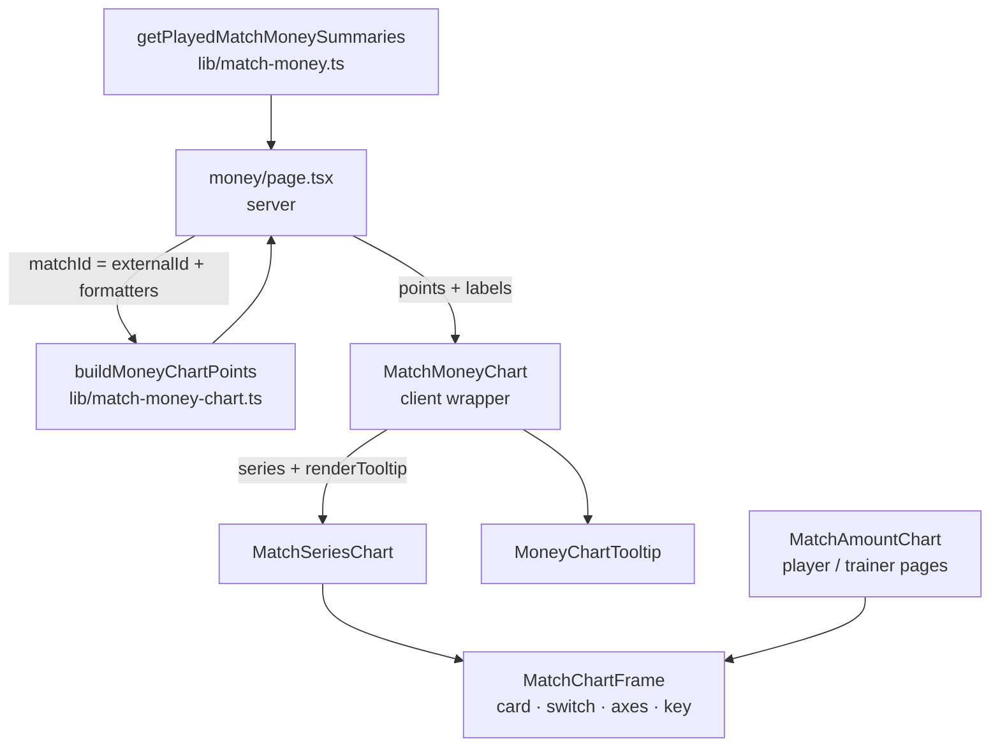

# Requirements

Changelog: improvement (all)

### Overview & Goals

The player and trainer detail pages show a per-match graph (`MatchAmountChart`). The match money
page (`/[lang]/money`, "Pokuty a platby") lists every played match with its fines, bonuses and
trainer payments, but has no overview of how much money each match brought in. Add the same kind
of graph above the match list, with two lines: money gathered from players and money gathered from
trainers, per match. A second view compares Podbrezová's team total with the opponent's.

The page is in every logged-in user's navigation (players see it read-only), so the graph is
visible to everyone.

### Scope

**In scope**
- A graph card on `/[lang]/money` between the season/league filter and the "Odohrané zápasy"
  section, hidden when the filtered season has no played match.
- View "Platby": two lines per match — player fines (`calculated_fine + streak_fine` summed over
  the match, the match card's "Pokuty" total) and trainer payments (the "Tréneri" total).
- View "Výkon tímu": two lines — Podbrezová's team total and the opponent's total.
- Tooltip on tap/hover: date · league, match label, pins `3812 : 3650`, both money rows with
  their unpaid part.
- A series mode for the shared chart in `components/charts/MatchAmountChart.tsx`, reusing its card,
  view switch, axes and key.
- Two new colour tokens, one new locale key, tests.

**Out of scope**
- Player bonuses on the graph (money leaving the bank).
- Cumulative / running-total values.
- Paid/unpaid colouring of the lines (stays in the tooltip only).
- Any change to the player and trainer graphs' look or behaviour.
- Any change to money calculation, SQL or `getPlayedMatchMoneySummaries()`.

### User Stories

- As a player, on "Pokuty a platby" I see at a glance which matches cost the team the most and how
  much came from trainers.
- As anyone, I tap a point to see the match, its score and how much of each amount is still unpaid.
- As anyone, I switch to "Výkon tímu" to compare our pins with the opponent's per match.
- The graph follows the season/league filter, like the list below it.

# Technical Design

### Current Implementation

- `app/[lang]/money/page.tsx` loads `getPlayedMatchMoneySummaries(seasonId, leagueKey)`
  (`lib/match-money.ts`), which returns per match `fines`, `finesUnpaid`, `bonuses`,
  `bonusesUnpaid`, `trainer`, `trainerUnpaid`, `teamTotalScore`, `opponentTotalScore`, newest
  first. Fines already include `streak_fine` per match row (same as the match card).
- `components/charts/MatchAmountChart.tsx` (client) draws one amount line coloured by
  `paymentState` (gradient + dots) and one score line, with a `ViewSwitch`
  (`amount` / `score`) and a `ChartKey`. Points must satisfy `MatchChartPoint`
  (`lib/match-chart.ts`: `matchId`, `amount`, `score`, `paymentState`, `shortDateLabel`).
- Page wrappers (`components/player/PlayerFineChart.tsx`, `components/trainer/TrainerPaymentChart.tsx`)
  exist because a server page cannot pass the `renderTooltip` function to a client component.
- Points are built server-side by pure helpers (`lib/player-fine-chart.ts`,
  `lib/trainer-payment-chart.ts`) using `datedOldestFirst()` / `scoreOrNull()` /
  `MatchChartFormatters` from `lib/match-chart.ts`.

### Proposed Changes

#### 1. Chart axis point type (`lib/match-chart.ts`)

Split the base so a series chart does not have to fake `amount` / `paymentState`:

```ts
/** One match on the X axis. */
export interface MatchChartAxisPoint {
  matchId: number;
  shortDateLabel: string;
}

export interface MatchChartPoint extends MatchChartAxisPoint {
  amount: number;
  score: number | null;
  paymentState: MatchPaymentState;
}
```

Nothing else in the file changes; existing importers keep compiling.

#### 2. Shared frame + series chart (`components/charts/MatchAmountChart.tsx`)

Extract the parts both modes share into an internal `MatchChartFrame<T extends MatchChartAxisPoint>`:
`Card` + `ViewSwitch` + `ChartContainer` + `LineChart` (grid, `XAxis` keyed by `matchId` with
`shortDateLabel` ticks, `YAxis` with `[0, 'auto']` + `€` formatter on `amount` and `['auto','auto']`
on `score`, `ChartTooltip` with `ActivePointTooltip`) + `ChartKey`. It takes
`renderLines(view)`, `keyEntries(view)` and an optional `className` (merged into the Card's `mb-8`
with `cn`, so the money page can pass `mb-0` inside its `space-y` layout).

- `MatchAmountChart` keeps its exact props and output; it renders the frame with the existing
  gradient/`PaymentStateDot`/score lines and the existing paid/unpaid/partial key entries.
- New export:

```ts
export interface MatchChartSeries<T> {
  dataKey: keyof T & string;
  label: string;
  /** A CSS colour, e.g. `var(--chart-players)`. */
  color: string;
}

export interface MatchSeriesChartLabels {
  view: string;
  views: Record<MatchChartView, string>;
}

export function MatchSeriesChart<T extends MatchChartAxisPoint>({
  points, labels, series, renderTooltip, className,
}: {
  points: T[];
  labels: MatchSeriesChartLabels;
  series: Record<MatchChartView, MatchChartSeries<T>[]>;
  renderTooltip: (point: T) => ReactNode;
  className?: string;
})
```

  For the active view it draws one `<Line type="monotone" strokeWidth={2} stroke={color}
  dot={{ r: 2.5, fill: color, strokeWidth: 0 }} activeDot={{ r: 5 }} connectNulls />` per series
  (keyed by `${view}-${dataKey}`), and the key lists the series' labels with their colours. The key
  text stays in muted ink; only the dot carries the colour.

#### 3. Colour tokens (`app/globals.css`)

Next to `--chart-score` in the light block (≈ line 76) and the dark block (≈ line 134):

```css
/* Money chart series: validated as a colour-blind-safe pair on both surfaces. */
--chart-players: #2a78d6;   /* dark: #3987e5 */
--chart-trainers: #eb6834;  /* dark: #d95926 */
```

The dataviz validator passed both modes (CVD ΔE ≥ 24, contrast ≥ 3:1 on white and on
`slate-950`). The score view uses the existing `--chart-score` for Podbrezová and
`var(--muted-foreground)` for the opponent.

#### 4. Point builder (`lib/match-money-chart.ts`, new, db-free)

Must not import from `lib/match-money.ts` (it reaches `lib/db.ts`, and the client tooltip imports
this module's types), so it declares its own source shape:

```ts
export interface MoneyChartSource extends DatedMatch {
  teamTotalScore: number | null;
  opponentTotalScore: number | null;
  fines: number;
  finesUnpaid: number;
  trainer: number;
  trainerUnpaid: number;
}

export interface MoneyChartPoint extends MatchChartAxisPoint {
  players: number;
  playersUnpaid: number;
  trainer: number;
  trainerUnpaid: number;
  teamScore: number | null;
  opponentScore: number | null;
  dateLabel: string;
  matchLabel: string;
  leagueLabel: string;
}

const cents = (value: number) => Math.round(value * 100) / 100;

/** Every played match, oldest first, at the totals its card in the list shows. */
export function buildMoneyChartPoints<T extends MoneyChartSource>(
  matches: T[],
  format: MatchChartFormatters<T>,
): MoneyChartPoint[] {
  return datedOldestFirst(matches).map((m) => ({
    matchId: m.matchId,
    players: cents(m.fines),
    playersUnpaid: cents(m.finesUnpaid),
    trainer: cents(m.trainer),
    trainerUnpaid: cents(m.trainerUnpaid),
    teamScore: scoreOrNull(m.teamTotalScore),
    opponentScore: scoreOrNull(m.opponentTotalScore),
    dateLabel: format.date(m.date),
    shortDateLabel: format.shortDate(m.date),
    matchLabel: format.match(m),
    leagueLabel: format.league(m),
  }));
}
```

#### 5. Tooltip (`components/money/MoneyChartTooltip.tsx`, new)

Same shell as `FineChartTooltip` (`grid min-w-48 max-w-72 gap-1.5 rounded-lg border … text-xs`):

- `{dateLabel} · {leagueLabel}` (muted), `{matchLabel}` (medium),
  `{teamScore ?? '—'} : {opponentScore ?? '—'}` (muted, tabular-nums).
- One row per money series: colour dot + label + `{amount} €` (mono, semibold) + status:
  - `amount === 0` → just `0 €` muted;
  - `unpaid > 0` → `({labels.unpaid} {unpaid} €)` in red-600 / red-400;
  - else → `({labels.paid})` in emerald-600 / emerald-400.

Labels: `{ players, trainer, paid, unpaid }`.

#### 6. Client wrapper (`components/money/MatchMoneyChart.tsx`, new, `'use client'`)

Like `PlayerFineChart`: receives `points` + plain-string labels from the page, builds
`series` and renders `<MatchSeriesChart … className="mb-0">` with
`renderTooltip={(point) => <MoneyChartTooltip point={point} labels={…} />}`:

```ts
series = {
  amount: [
    { dataKey: 'players', label: labels.players, color: 'var(--chart-players)' },
    { dataKey: 'trainer', label: labels.trainer, color: 'var(--chart-trainers)' },
  ],
  score: [
    { dataKey: 'teamScore', label: labels.team, color: 'var(--chart-score)' },
    { dataKey: 'opponentScore', label: labels.opponent, color: 'var(--muted-foreground)' },
  ],
};
```

#### 7. Page (`app/[lang]/money/page.tsx`)

- Build points:
  ```ts
  const chartPoints = buildMoneyChartPoints(
    matches.map((m) => ({ ...m, matchId: m.externalId })),
    {
      date: (iso) => formatDateOnly(iso, lang),
      shortDate: (iso) => formatShortDate(iso, lang),
      match: (m) => matchLabel(m.opponent, m.isHome),
      league: (m) => leagueLabelForId(m.leagueId, m.leagueName, dict),
    },
  );
  ```
- Render between the sticky filter `div` and the `<section>`, only when `chartPoints.length > 0`:
  ```tsx
  <MatchMoneyChart
    points={chartPoints}
    labels={{
      view: dict.playerDetail.chartView,
      views: { amount: dict.trainerDetail.chartPayments, score: dict.trainerDetail.chartScore },
      players: t.playersTitle,
      trainer: t.trainerTitle,
      team: t.chartTeam,
      opponent: dict.admin.matches.opponent,
      paid: t.paid,
      unpaid: t.unpaid,
    }}
  />
  ```

#### 8. Locales (`locales/{sk,cs,hu,sr}.json`)

One new key `money.chartTeam` = `"Podbrezová"` in all four (the club name, kept out of the
code). Everything else reuses existing keys: `trainerDetail.chartPayments` ("Platby"),
`trainerDetail.chartScore` ("Výkon tímu"), `money.playersTitle` ("Pokuty hráčov"),
`money.trainerTitle` ("Platby trénerov"), `admin.matches.opponent` ("Súper"), `money.paid`,
`money.unpaid`, `playerDetail.chartView`.

#### 9. Changelog entry (`lib/changelog/entries/<date>-money-page-chart.ts`)

`type: 'improvement'`, `audience: 'all'`, registered in `lib/changelog/entries/index.ts`.
Draft sk (to approve after implementation):
`V prehľade pokút a platieb teraz uvidíš graf, koľko sa v jednotlivých zápasoch vyzbieralo od hráčov a od trénerov.`

### Architecture Diagram



### Key Decisions

- **Extend the shared chart file with a frame + series mode** rather than a standalone money chart
  (chosen by the developer): card, switch, axes and key stay in one place; the player/trainer
  `MatchAmountChart` API and output are unchanged.
- **Fixed series colours, paid state only in the tooltip**: a paid/unpaid gradient on two lines
  would make players and trainers indistinguishable.
- **Per match, fines only**: matches the per-match cards below; bonuses are money leaving the bank.
- **Short-date X ticks**: opponent names do not fit a ~350 px mobile axis; they are in the tooltip.
- **Score view = Podbrezová vs opponent**, same pins axis (no dual axis); opponent in muted grey
  so our team stays the focus.
- **Builder declares its own source type** instead of importing `PlayedMatchMoneySummary`,
  keeping `lib/db.ts` out of the client bundle (Client/Server Boundary invariant).

### Edge Cases / Risks

- Match without a date: dropped by `datedOldestFirst()` (same as the other graphs).
- Opponent score missing or team total 0: `scoreOrNull` → `null`, the score line bridges the gap
  (`connectNulls`), tooltip shows `—`.
- A match with 0 € on both lines still gets points at 0.
- Cent amounts (⅓ shares, e.g. 0.33 €): rounded to cents so the tooltip never shows float noise.
- League filter: per-match fines include `streak_fine` (as on the match cards); unchanged behaviour.
- Single match: one dot per line, no segment — acceptable, same as the player graph.
- Refactoring `MatchAmountChart` could change the player/trainer graphs: the existing
  `MatchAmountChart.test.tsx` must pass unchanged.

# Delivery Steps

### ✓ Step 1: Split the axis point type
Files: `lib/match-chart.ts`. Add `MatchChartAxisPoint`, make `MatchChartPoint` extend it.
Verify: `pnpm tsc --noEmit` (or the project's type-check script).

### ✓ Step 2: Extract the frame and add `MatchSeriesChart`
Files: `components/charts/MatchAmountChart.tsx`, `components/charts/MatchAmountChart.test.tsx`.
Add tests for `MatchSeriesChart`: opens on the amount view; key lists "Pokuty hráčov" /
"Platby trénerov" and no paid/unpaid; switching to the score view swaps the key to
"Podbrezová" / "Súper"; with the `getBoundingClientRect` mock the two `path.recharts-line-curve`
strokes are `var(--chart-players)` and `var(--chart-trainers)`. Existing tests unchanged and green.

### ✓ Step 3: Add colour tokens
Files: `app/globals.css` (light and dark blocks).

### ✓ Step 4: Point builder + tests
Files: `lib/match-money-chart.ts`, `lib/match-money-chart.test.ts`.
Cases: oldest first from newest-first input; undated match dropped; amounts and unpaid carried
and rounded to cents (`0.1 + 0.2` source sum → `0.3`, `0.33`); team total `0` → `null`;
opponent `null` stays `null`; labels come from the formatters.

### ✓ Step 5: Tooltip + tests
Files: `components/money/MoneyChartTooltip.tsx`, `components/money/MoneyChartTooltip.test.tsx`.
Cases (sk labels): renders date · league, match label, `3812 : 3650`; `23 €` with
`(Nezaplatené 8 €)`; `15 €` with `(Zaplatené)`; `0 €` without status; missing opponent score `—`;
cent amount `13.33 €` exact.

### ✓ Step 6: Client wrapper, page and locale key (manual browser check still pending)
Files: `components/money/MatchMoneyChart.tsx`, `app/[lang]/money/page.tsx`,
`locales/{sk,cs,hu,sr}.json` (`money.chartTeam`). Restart `pnpm dev` (new locale key), open
`/sk/money`, check both views, tooltip on tap, light/dark, mobile width, filter switching,
and a season with no matches (no card).

### ✓ Step 7: Changelog entry
Run the `changelog` skill (mode 2): show sk/cs/hu/sr texts for approval, then write
`lib/changelog/entries/<yyyy-mm-dd>-money-page-chart.ts`, register it in
`lib/changelog/entries/index.ts`, run `pnpm test:run lib/changelog`.

### ✓ Step 8: Final check
Run `pnpm check` (lint + type check + tests). No errors, no `any`.

# Testing

### Validation Approach

- **Unit**: `lib/match-money-chart.test.ts` (builder), `components/money/MoneyChartTooltip.test.tsx`
  (money-displaying component: exact amounts and unpaid parts),
  `components/charts/MatchAmountChart.test.tsx` (new series mode + existing tests untouched as a
  regression guard for the player/trainer graphs), `locales/locales.test.ts` (new key in all four
  locales), `lib/changelog/entries/entries.test.ts` (entry registered).
- No money calculation changes, so no `money-rules` tests and no rules/locales `rules` updates.
- **Manual** (`pnpm dev`, `/sk/money`, phone width + desktop, light + dark):
  - graph above "Odohrané zápasy", blue players line, orange trainers line, key under the graph;
  - tap a point → tooltip amounts equal the match card's "Pokuty" / "Tréneri" chips;
  - "Výkon tímu" → blue Podbrezová and grey opponent lines, key swaps;
  - change season/league → graph follows; empty season → no graph card;
  - player and trainer detail graphs look and behave as before.
- **Final**: `pnpm check` passes.
