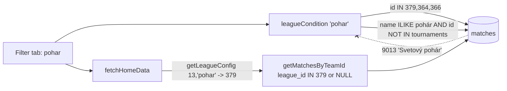

# Requirements

### Overview & Goals

Selecting **Slovenský pohár** in the season/league filter shows the hand-entered World Cup
qualification (match `900000001`, `league_id = 9013`, `league_name = 'Svetový pohár'`,
season 13). The cup has not started in 2026/2027, so the tab should be empty.

Root cause, confirmed in code and against the database:

1. **Name fallback catches the World Cup.** `leagueCondition('pohar')` in `lib/db-utils.ts:211`
   matches `m.league_name ILIKE '%pohár%'` alongside the cup ids. `saveManualMatch()` stamps
   manual matches with `league_name = league.name`, and the World Cup's config name is
   `'Svetový pohár'`, which contains "pohár". So every query that uses the cup filter picks
   it up: player balances, unpaid debtors, bank balance, player and trainer detail pages.
2. **No cup league for season 13.** `SEASONS_CONFIG` has no `pohar` entry for season 13, so
   `fetchHomeData()` (`lib/home-helpers.ts:190`) gets `targetLeague = undefined`, passes no
   league ids to `getMatchesByTeamId()`, and the home calendar on the cup tab lists **every**
   season-13 match (Interliga and tournaments).

The user supplied the 2026/2027 cup league id: **379**. The results API confirms it
(`/league/detail {id: 379}` returns `"Slovenský pohár muži 2027"`, `seasonId: 13`, the same
format as `364` = `"…muži 2026"`, season 12). The team id is not known yet.

Goal: the cup tab shows only cup matches, in every view and for both seasons.

### Scope

**In Scope**
- Add league `379` (`key: 'pohar'`, `teamIds: []`) to season 13 in `lib/season-config.ts`.
- Stop the cup's name fallback from matching tournament leagues in `leagueCondition()`.
- Tests for both changes.
- One line in the AGENTS.md "Seasons, Leagues, Ids" invariants about the fallback.

**Out of Scope**
- The cup team id for 2026/2027. It goes into `teamIds` later; until then the scraper does
  not fetch cup fixtures (it only walks team ids). This is expected.
- Money calculation. `recalculateDerivedFinancials()` does not use the cup name match (its
  under-limit scope is Interliga + tournament ids), so no stored fine is wrong. No change to
  `lib/sync.ts`, `lib/money-rules.ts` or the `rules` locales.
- The Interliga name fallback (`'%interliga%'`). No manual league name contains it.

### Functional Requirements

- FR1: In season 13, the cup tab shows no matches, no balances and no debtors until a cup
  match exists.
- FR2: In season 12, the cup tab still shows its 9 cup matches (`league_id = 364`).
- FR3: A manual tournament match never shows under the cup tab, in any season, whatever its
  `league_name`.
- FR4: Rows with `league_id IS NULL` (unplayed scraped fixtures) still reach the calendar
  through `includeUnassigned`, and the cup name fallback still applies to rows with a
  missing or unconfigured league id.

# Technical Design

### Current Implementation

```ts
// lib/db-utils.ts:210
if (leagueKey === 'pohar') {
  return sql`AND (${unassigned}m.league_id IN (${idList(POHAR_LEAGUE_IDS)}) OR m.league_name ILIKE '%pohár%' OR m.league_name ILIKE '%pohar%' OR m.league_name ILIKE '%finále%' OR m.league_name ILIKE '%finale%')`;
}
```

Database today (read-only query): the only rows the name fallback matches are the 9 real cup
rows (`364`, which the id list already covers) and the World Cup qualification (`9013`). No
row has `league_id IS NULL` and none has `366`.

### Proposed Changes

#### 1. Season config (`lib/season-config.ts`)

Add the cup to season 13, between Interliga and the tournaments (same order as season 12):

```ts
{
  leagueId: 379,
  // The team id is registered once the first round is drawn.
  teamIds: [],
  key: 'pohar',
  name: 'Slovenský pohár',
},
```

Effects, checked:
- `POHAR_LEAGUE_IDS` becomes `[379, 364, 366]`.
- `getLeagueConfig(13, 'pohar')` returns it, so `fetchHomeData()` passes `[379]` and the
  calendar narrows correctly. `effectiveTeamId` falls back to `getTeamIdsForSeason(13)[0]`
  (5008) because `teamIds[0]` is undefined.
- `getAllTeamIds()` / `getTeamIdsForSeason()` gain nothing from an empty list, so the scraper
  and `isHome` detection are unchanged.
- `getSeasonAndLeagueConfig()` now matches `leagueId === 379` by id. Its name branch compares
  exact names, and the API sends `"Slovenský pohár muži 2027"`, so it cannot mis-stamp a
  season-12 row.
- `lib/money-rules.test.ts` takes `const [poharId] = POHAR_LEAGUE_IDS`, which becomes 379.
  That is still a cup id outside the Interliga and tournament lists, so the "Slovak Cup is
  exempt" cases keep their meaning.

The comment line is a `why` comment (explains the empty list) and is allowed.

#### 2. Cup filter (`lib/db-utils.ts`, `leagueCondition()`)

Keep the name fallback, but never let it match a tournament id. `NOT IN` on NULL yields
NULL, so the id is wrapped in `COALESCE`, or unstamped rows would drop out of the fallback.
(`COALESCE` rather than `m.league_id IS NULL OR …`: the existing test asserts that the
money-scoped condition never contains `m.league_id IS NULL`.)

```ts
if (leagueKey === 'pohar') {
  // "Svetový pohár" contains "pohár", so the name fallback must skip our tournament ids.
  // COALESCE keeps a NULL id in the fallback, where a bare NOT IN would drop it.
  const notTournament = sql`COALESCE(m.league_id, 0) NOT IN (${idList(TOURNAMENT_LEAGUE_IDS)})`;
  return sql`AND (${unassigned}m.league_id IN (${idList(POHAR_LEAGUE_IDS)}) OR (${notTournament} AND (m.league_name ILIKE '%pohár%' OR m.league_name ILIKE '%pohar%' OR m.league_name ILIKE '%finále%' OR m.league_name ILIKE '%finale%')))`;
}
```

`TOURNAMENT_LEAGUE_IDS` is already imported in this file (the `turnaje` branch uses it). If
not, add it to the existing `@/lib/season-config` import.

#### 3. Invariants (`AGENTS.md`)

Under "Seasons, Leagues, Ids" add:

> - The cup filter's name fallback (`'%pohár%'`) skips tournament ids, because "Svetový
>   pohár" contains "pohár". Any new name-based league match must exclude manual leagues the
>   same way.

(Restore the `proxy.ts` rule if `next dev` has rewritten the header, per memory.)

### Architecture Diagram



### Key Decisions

- **Exclude tournaments from the fallback instead of dropping it.** The user did not pick
  one of the two options, so this plan follows the recommendation: it is the smaller behaviour
  change, and it keeps a safety net for a scraped cup row with a missing or new league id.
  Dropping the fallback (id-only, like tournaments) would also work, since no row relies on it
  today. It is a one-line swap if preferred.
- **Add 379 now with an empty `teamIds`.** It fixes the home-calendar half of the bug, which
  the SQL fix alone does not touch, and it is the id the scraper will stamp once the team id
  arrives.
- **Exclusion by id, not by name** (`NOT ILIKE '%svetov%'` was rejected): the invariants say
  league identity is keyed by id, and our tournament ids are stable.

### Edge Cases / Risks

- `league_id IS NULL` row named "…pohár…": still matched (NULL branch). Covered by a test.
- Cache: cached reads live a week and are keyed by filter. After deploy, press admin **Sync**
  (`updateSyncedData()`) so the cup tab entries are rebuilt. Locally, delete
  `.next/dev/cache/fetch-cache` (memory: local cache stays stale).
- When the cup team id arrives, adding it to `teamIds` makes the scraper fetch cup fixtures.
  No other change is needed.

# Delivery Steps

### ✓ Step 1: Write the failing filter test
`lib/db-utils.test.ts`, in `describe('leagueCondition')`: add a test that the rendered
`leagueCondition('pohar')` contains `NOT IN (${TOURNAMENT_LEAGUE_IDS.join(', ')})` and keeps
`m.league_id IS NULL OR m.league_id NOT IN` (so unstamped rows still reach the fallback). Run
`pnpm test:run lib/db-utils.test.ts`; it must fail before Step 2.

### ✓ Step 2: Narrow the cup name fallback
`lib/db-utils.ts`: rewrite the `pohar` branch of `leagueCondition()` as in Proposed Change 2.
Re-run the test file; all `leagueCondition` tests pass (the existing `finále` / `pohar` /
`IS NULL` assertions still hold).

### ✓ Step 3: Add the 2026/2027 cup league
`lib/season-config.ts`: add league 379 to season 13 (Proposed Change 1).
`lib/season-config.test.ts`: add cases that
- `getLeagueConfig(13, 'pohar')?.leagueId` is `379` and `getLeagueConfig(12, 'pohar')?.leagueId` is `364`;
- `POHAR_LEAGUE_IDS` contains `379`, `364`, `366` and no `TOURNAMENT_LEAGUE_IDS` member;
- `getTeamIdsForSeason(13)` is still `[5008]` (the empty cup list adds nothing).

### ✓ Step 4: Record the invariant
`AGENTS.md`: add the line from Proposed Change 3.

### ✓ Step 5: Verify against real rows (read-only, not committed)
Run the rendered `leagueCondition('pohar')` against the database in an ad-hoc `node -e`
query (never a file in `scripts/`):
- season 13 → 0 rows (previously 1: `900000001`);
- season 12 → 9 rows, all `league_id = 364`.

### ✓ Step 6: Lint, type check, tests
`pnpm check` (lint + type check + full test suite) must pass with no errors.

# Testing

### Validation Approach

- **Unit tests** (`lib/db-utils.test.ts`, `lib/season-config.test.ts`): the fallback excludes
  tournament ids and keeps NULL league ids; 379 is the season-13 cup and the id lists stay
  disjoint. The `money-rules.test.ts` cup cases keep passing with `poharId = 379`.
- **Data check** (Step 5): season 13 cup → 0 rows, season 12 cup → 9 rows.
- **Manual flow** after `rm -rf .next/dev/cache/fetch-cache` and `pnpm dev`:
  1. Home, season 2026/2027, tab Slovenský pohár → no World Cup match in the calendar or
     match list, no balances or debtors.
  2. Same season, tab Turnaje → the World Cup qualification is still there.
  3. Season 2025/2026, tab Slovenský pohár → the 9 cup matches as before.
  4. A player who played the qualification → their detail page, cup tab, does not list it.
  5. Check light and dark mode on mobile width (layout unchanged).
- **Final check**: `pnpm check` passes.
