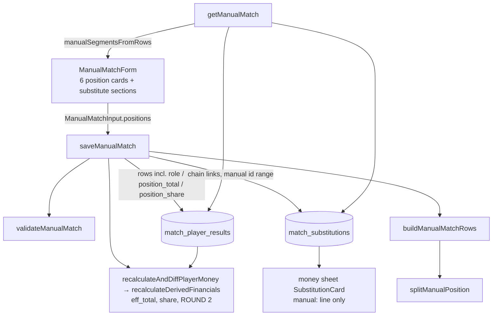

# Requirements

### Overview & Goals

The admin's manual-match form (`/[lang]/admin/matches`) is a flat list of player cards. A
substitute is entered today by adding a 7th card ("Pridať hráča"), which says nothing about
**whom** they replaced or **from which throw**. So the result rows carry no
`substitution_role` / `position_total` / `position_share`, and the money is computed as if the
substitute had been a seventh starter. Concretely, under 600, worst in team and the 700 bonus
are judged on each part of the game instead of the position's combined result.

Goal: a match always has exactly **6 position cards**. Each card has a **"Striedanie hráča"**
button at its bottom-left that opens a substitute section inside the same card: player,
**from-throw** number, and the substitute's own full / clean / faults. A substitute can be
substituted again (chain). A manual substitution then produces the same rows, the same stats
and the same money as a scraped one.

### Scope

**In scope**
- Manual-match form: 6 fixed position cards, no add/remove buttons. Up to 2 substitutions per
  card as a chain, and at most 2 per match. Shown only from season 13.
- Validation, the server action, and loading a substituted match back into the form for editing.
- Writing `substitution_role`, `position_total` and `position_share` on manual rows, and storing
  the chain in `match_substitutions`.
- A new **three-player** split rule (two substitutions in one position), plus rounding
  share-based money to cents (a ⅓ share).
- Money sheet `SubstitutionCard`: manual substitutions show without the lane-fault note.
- AGENTS.md Money Calculation Rules / Codebase Invariants and `rules` text in all four locales.

**Out of scope**
- Two substitutions in one position of a **scraped** match (very unlikely for our team, and
  `splitPosition()` stays two-player).
- Migrating old manual matches (the DB holds **no** manual matches today, checked 2026-10-18).
- Paid-row protection when an edit drops a player (today's behaviour, unchanged).
- Lane-by-lane entry. The admin types each player's own part directly.

### Functional Requirements

1. The form shows exactly 6 position cards. Saving requires a player in every card
   (`incompletePositions`).
2. From season 13 (`SUBSTITUTION_FIRST_SEASON_ID`) each card shows a **"Striedanie hráča"**
   button at its bottom-left. It opens a substitute section in that card with:
   - player select
   - "Od hodu" (required, integer **2–120**, starts empty; the hint says 61 = from the half)
   - the substitute's own full / clean / faults
   - a remove (X) button
3. Inside an open substitute section the button appears again, to substitute the substitute.
   The second section's throw must be **greater** than the first (`invalidThrowNumber`).
4. A match has at most **2 substitutions in total**. Once two are used, the button disappears
   from every card, and the server rejects a third (`tooManySubstitutions`). A substitution
   before season 13 is rejected (`substitutionNotAllowed`).
5. Every player, starter or substitute, enters **only their own part**. The card shows the
   **position total** (sum of its players), and the team total sums the positions.
6. Each player pays their own faults (fault fine, faultless streak). Everyone in the position
   pays the team-loss and team-under-limit fines in full.
7. **Who holds the position:** the player with the most throws.
   - Their row counts in stats (avg / max / games) and carries the combined full / clean / total.
   - Every other row keeps only its own numbers and shows the "Striedal" badge.
   - On a tie for the most throws, the earliest tied player holds the position.
   - Under 600, worst in team and the 700 bonus are judged on the combined position total and
     split equally among the tied players: 1, ½ / ½ (switch at 61), or ⅓ / ⅓ / ⅓ (switches at
     41 + 81). Each player's amount is rounded to cents, so 0.33€ / 13.33€.
8. Editing a saved match rebuilds the same cards, with chains and each player's own numbers.
9. The same person can appear only once per match (`duplicatePlayer`, enforced by the
   `(match_id, user_id)` PK).

# Technical Design

### Current Implementation

- `app/[lang]/admin/matches/ManualMatchForm.tsx`:
  - `PlayerRow { key, userId, full, clean, faults }`; `DEFAULT_ROWS = 6`.
  - "Pridať hráča" appends a row (`:456`), X removes one (`:437`), and blank rows are dropped on
    submit.
  - The hint `playersHint` says "add an extra player".
- `lib/validation/manual-match.ts`:
  - `ManualMatchInput.players: ManualMatchPlayerInput[]`, `MAX_PLAYERS = 12`.
  - Errors: `noPlayers`, `duplicatePlayer`, `invalidScore`, `invalidMatchPoints`, …
- `lib/manual-match-actions.ts` `saveManualMatch()`:
  - Builds `playerRows` inline (`:79-91`) and sets `teamTotalScore = Σ total`.
  - Upserts on `(match_id, user_id)` without the substitution columns.
  - `deleteManualMatch()` does not touch `match_substitutions`.
- `lib/manual-matches.ts` `getManualMatch()` loads the players sorted by name, with no
  substitution data.
- Scraped substitutions:
  - `splitPosition()` (`lib/substitutions.ts`, pure, no imports) splits a position between two
    players from lane data.
  - `syncSubstitutions()` (`lib/match-substitutions.ts`) writes the columns, only for match ids
    taken from `match_detail` snapshots, so it never touches manual matches.
  - `match_substitutions` (`lib/db/schema.ts:84`): `id` (API id, today max 8585), `match_id`,
    `starter_user_id`, `substitute_user_id`, `throw_number`, `lane_faults`,
    `split_lane_substitute_faults`.
- `recalculateDerivedFinancials()` (`lib/sync.ts:141`) reads only the columns:
  - `eff_total = COALESCE(position_total, total)` and `share = COALESCE(position_share, 1)`.
  - "Played" is `total > 0 OR substitution_role IS NOT NULL`.
  - Trainer counts skip `'minor'` rows.
  - Shares multiply fines/bonus **without rounding**.

  So manual rows that carry the columns get correct money with no new SQL logic. Only rounding
  is new.

### Proposed Changes

#### 1. Pure split for manual positions (`lib/substitutions.ts`)

New db-free functions next to `splitPosition()`, which stays untouched.

```ts
export interface ManualSegment {
  userId: string;
  /** First throw this player bowled; the starter's is 1. */
  fromThrow: number;
  full: number;
  clean: number;
  faults: number;
}

export interface ManualPositionRow {
  userId: string;
  full: number;        // combined for the holder, own for everyone else
  clean: number;
  total: number;
  faults: number;      // always own
  substitutionRole: SubstitutionRole | null;
  positionTotal: number | null;
  positionShare: number | null;
}

/** One manual position (starter + 0–2 substitutes, in order) as result rows. */
export function splitManualPosition(segments: ManualSegment[]): ManualPositionRow[]
```

Rules:
- **One segment:** return own values, with role, position total and share all `null`.
- **Throws:** `throws_i = (segments[i+1]?.fromThrow ?? THROWS_PER_GAME + 1) - segments[i].fromThrow`.
- `maxThrows = max(throws)`; `tied` = segments with `throws === maxThrows`; `holder = tied[0]`.
- **Holder:** `'major'`, with `full / clean / total` summed over all segments.
- **Everyone else:** `'minor'`, with own values.
- **All rows:** `positionTotal = Σ own totals`; `positionShare = tied.includes(s) ? 1 / tied.length : 0`.

The inverse rebuilds the form's own values on edit:

```ts
/** Inverse of splitManualPosition: each player's own part, holder's = combined − others. */
export function manualSegmentsFromRows(
  chain: { userId: string; fromThrow: number }[],
  rows: Map<string, { full: number; clean: number; faults: number; role: SubstitutionRole | null }>,
): ManualSegment[]
```

#### 2. Validation (`lib/validation/manual-match.ts`)

Replace `players` with positions.

```ts
export const POSITION_COUNT = 6;
export const MAX_SUBSTITUTIONS = 2;   // per match; a card can hold both

export interface ManualMatchSubstitutionInput extends ManualMatchPlayerInput {
  fromThrow: number;
}
export interface ManualMatchPositionInput {
  starter: ManualMatchPlayerInput;
  substitutions: ManualMatchSubstitutionInput[];
}
// ManualMatchInput: `players` → `positions: ManualMatchPositionInput[]`
```

- **Error codes:** drop `noPlayers`; add `incompletePositions`, `tooManySubstitutions`,
  `invalidThrowNumber`, `substitutionNotAllowed`. Drop `MAX_PLAYERS`.
- **Order of checks in `validateManualMatch()`:**
  1. league
  2. date
  3. `positions.length === POSITION_COUNT` and every starter / substitute has a `userId` → `incompletePositions`
  4. total substitutions `> MAX_SUBSTITUTIONS` → `tooManySubstitutions`
  5. any substitution with `seasonId < SUBSTITUTION_FIRST_SEASON_ID` → `substitutionNotAllowed`
  6. each `fromThrow` is an integer in `2..120`, strictly increasing within a position → `invalidThrowNumber`
  7. unique user ids across all starters and substitutes → `duplicatePlayer`
  8. scores (`invalidScore`); the opponent total max becomes `MAX_SCORE * POSITION_COUNT`
  9. match points (unchanged)

`SUBSTITUTION_FIRST_SEASON_ID` is imported from `lib/substitutions.ts`, which has no imports
and is client-safe.

#### 3. Row builder (`lib/manual-match-rows.ts`, new, db-free)

The row building moves out of the `'use server'` file so it can be unit tested.

```ts
export interface ManualMatchRows {
  players: (ManualPositionRow & { avg: string })[];
  /** Chain links in order; ids are allocated by the caller. */
  substitutions: { starterUserId: string; substituteUserId: string; throwNumber: number }[];
  /** Σ position totals: never Σ row totals, the holder's row already holds the combined total. */
  teamTotalScore: number;
}
export function buildManualMatchRows(positions: ManualMatchPositionInput[]): ManualMatchRows
```

- Each position becomes `[{ ...starter, fromThrow: 1 }, ...substitutions]` and is passed to
  `splitManualPosition()`.
- `avg` comes from `computeAverage(total)` (`lib/sync-transform.ts`).
- A chain link is `starterUserId = previous segment's player`, `substituteUserId = this one`.
- `positionShare` is stored as `String(share)`, e.g. `'0.3333333333333333'`. Rounding happens
  in the money step (#5).

#### 4. Server actions (`lib/manual-match-actions.ts`)

`saveManualMatch()`:
- Uses `buildManualMatchRows(input.positions)` and adds `matchId` / `teamId` to each row.
- Writes `teamTotalScore` from the builder.
- Player upsert: add `substitutionRole`, `positionTotal`, `positionShare` to both `values` and
  the `onConflictDoUpdate.set` (`EXCLUDED.*`). An edit that removes a substitution then
  resets the remaining row's columns to `NULL`.
- After the match upsert: `DELETE FROM match_substitutions WHERE match_id = matchId`, then insert
  the chain with `laneFaults: 0` and `splitLaneSubstituteFaults: null`.
- New ids come from `allocateSubstitutionIds(count)`, using the same pattern as `allocateMatchId()`:
  `COALESCE(MAX(id), MANUAL_MATCH_ID_BASE) + 1 … WHERE id >= MANUAL_MATCH_ID_BASE`. They stay
  in the reserved manual range, far above API ids.
- Write order (FKs): match upsert → delete subs → delete dropped players → upsert players →
  insert subs.

`deleteManualMatch()`: add `db.delete(matchSubstitutions)…` as the first statement of the batch,
because `match_substitutions.match_id` does not cascade.

#### 5. Rounding share-based money to cents (`lib/sync.ts`, `lib/money-rules.ts`)

In the `UPDATE match_player_results`:

```sql
bonus_received  = CASE WHEN s.eff_total >= 700 THEN ROUND(40 * s.share, 2) ELSE 0 END,
calculated_fine = …
                + CASE WHEN s.eff_total = s.min_total AND s.eff_total > 0
                       THEN ROUND(1 * s.share, 2) ELSE 0 END
                + CASE WHEN s.eff_total < 600 AND s.eff_total > 0
                       THEN ROUND(1 * s.share, 2) ELSE 0 END
                …
```

- Shares of 1 / 0.5 / 0 are unchanged by this.
- Update the comment above the query to say "more throws, ties split equally".
- Mirror in `derivePlayers()`: add `roundCents(value) = Math.round(value * 100) / 100`, with a
  one-line comment naming `ROUND(…, 2)` in sync.ts, and apply it to the three share-multiplied
  terms. Same commit.

#### 6. Loading for edit (`lib/manual-matches.ts`)

- `getManualMatch()` also selects `substitutionRole` per player and the match's
  `match_substitutions` rows (`starterUserId`, `substituteUserId`, `throwNumber`).
- It rebuilds positions:
  - **Roots:** players who are never a `substituteUserId`.
  - **Chain:** follow `starterUserId → substituteUserId` ordered by `throwNumber`.
  - `manualSegmentsFromRows()` recovers each player's own numbers.
  - Positions are sorted by the starter's name, as today.
- Types: `ManualMatchDetail.players` → `positions: { starter: ManualMatchPlayer;
  substitutions: (ManualMatchPlayer & { fromThrow: number })[] }[]`.
- `listManualMatches().playersCount` stays a row count; the list shows people, which is fine.

#### 7. Form (`app/[lang]/admin/matches/ManualMatchForm.tsx`)

- **State:** `PositionCard { key; starter: PlayerFields; substitutions: (PlayerFields & {
  fromThrow: string })[] }`, always 6 cards (`POSITION_COUNT`).
- **Removed:** "Pridať hráča", the card X, and the blank-row filter. Every card is sent;
  validation reports empty ones.
- **Card layout (mobile-first):**
  1. starter row (select + full / clean / faults / total, as today)
  2. each substitute section, indented with a left border (`border-l-2 pl-3`): "Od hodu"
     number input (`min 2`, `max 120`, `inputMode="numeric"`), player select, full / clean /
     faults / own total, and an X that removes this section and any after it
  3. footer, left: an outline `sm` button with `ArrowRightLeft` and "Striedanie hráča"
     (`addSubstitution`), shown when `seasonId >= SUBSTITUTION_FIRST_SEASON_ID`, the card has
     fewer than 2 substitutions, and the match has fewer than `MAX_SUBSTITUTIONS`
  4. footer, right: "Pozícia: {total}" (`positionTotal`), shown only when the card has a
     substitution
- **Season change:** if the new season is below 13, the existing substitute sections are
  cleared so a stale one cannot be submitted.
- `usedIds` covers starters and substitutes, so the player selects keep excluding people already
  used anywhere.
- Team total = Σ of every player's own total.
- New translations in `ManualMatchFormTranslations`: `position` ("{n}. pozícia"),
  `addSubstitution`, `substitute`, `fromThrow`, `fromThrowHint`, `removeSubstitution`,
  `positionTotal`. `playersHint` gets new wording, and `addPlayer` / `removePlayer` are dropped.
- `app/[lang]/admin/matches/page.tsx` passes the new keys.

#### 8. Money sheet (`lib/substitutions.ts`, `components/money/SubstitutionCard.tsx`)

- `SheetSubstitution` gains `manual: boolean`. `toSheetSubstitution()` takes the match id
  (`isManualMatchId` from `season-config`) or a flag passed by `getMatchSubstitutions()`.
  Keep `lib/substitutions.ts` import-free by passing the flag in.
- For a manual substitution, `SubstitutionCard` shows only `substitutionLine` plus a new
  `money.substitutionManual` ("Ručne zadaný zápas — chyby zadal admin pri každom hráčovi.").
  It shows no lane line and no split input.
- `getPendingSubstitutionCounts()` already skips them (`lane_faults = 0`).

#### 9. Locales (`locales/{sk,cs,hu,sr}.json`)

- `admin.matches`:
  - new keys from #7
  - new errors `incompletePositions`, `tooManySubstitutions`, `invalidThrowNumber`, `substitutionNotAllowed`
  - remove `noPlayers`, `addPlayer`, `removePlayer`
  - reword `playersHint`, e.g. sk: "Vždy 6 pozícií. Pri striedaní otvor v karte hráča
    „Striedanie hráča“ a zadaj, od ktorého hodu striedajúci hádzal."
  - The button reads sk "Striedanie hráča", cs "Střídání hráče", plus the hu / sr equivalents.
- `money.substitutionManual` in all four.
- `rules` substitution paragraph (sk `:433` and its cs / hu / sr equivalents): a position can
  have up to two substitutions; the player with the most throws holds it; ties split equally,
  rounded to cents.
- Use the `translations` skill when editing locales.

#### 10. AGENTS.md

- **Money Calculation Rules → Substitutions:**
  - Add a "Manual matches" bullet: the admin enters each player's own part plus the from-throw,
    up to 2 per match and chained within a card, from season 13; `buildManualMatchRows()` is
    the writer.
  - Extend "Who holds the position" to the three-player tie rule.
  - Note `ROUND(…, 2)` of share-based amounts.
- **Codebase Invariants → Derived Money Fields:** `syncSubstitutions()` stays the only writer of
  the substitution columns **for scraped matches**; manual matches get them from
  `saveManualMatch()`, and manual `match_substitutions` ids live in the `MANUAL_MATCH_ID_BASE`
  range.
- **Testing Rules → required cases:** add the manual split cases.

Restore the proxy.ts header line if `next dev` rewrote AGENTS.md (see memory).

### Architecture Diagram



### Key Decisions

- **Each player enters their own part, not the combined result** (user). This is the natural
  input; the combined total is derived.
- **Same holder rule as scraped** (user): the holder's row carries the combined total so stats
  stay comparable; ties split equally (user). A ⅓ share is **rounded to cents** (user) rather
  than forbidden or given to one player.
- **Chain, max 2 per match** (user, league rule): validated server-side; the UI only hides the
  button.
- **Fixed 6 positions** (user): "Pridať hráča" has no purpose once substitutes live in cards.
- **Season 13+ only**: matches the scraped split; the DB holds no older manual matches.
- **Reuse `match_substitutions`** rather than a new throw column: one source of "who replaced
  whom", the money sheet lists manual substitutions for free, and edit can rebuild chains.
  Manual ids go in the `MANUAL_MATCH_ID_BASE` range.
- **New `splitManualPosition()` instead of extending `splitPosition()`**: scraped splitting
  works from lanes and handles exactly two players; manual input has per-player numbers and up
  to three. Two small pure functions are clearer than one with modes.
- **Row building in a db-free module** so it is unit testable without mocking SQL (the action
  file is `'use server'` and its test mocks `db`).

### Edge Cases / Risks

- **Double-counting the team total**: the holder row already carries the combined total, so
  `teamTotalScore` must be Σ position totals. Covered by a builder test.
- **Edit removing a substitution**: the remaining row's columns must go back to `NULL`. The
  upsert `set` includes them, and the substitute's row is deleted by the existing "dropped
  players" delete. A paid row of a removed substitute is deleted too (pre-existing behaviour,
  out of scope).
- **Edit changing who holds the position**, e.g. a throw moving from 91 to 31: rebuilding from
  own values plus the new throw re-derives everything. Covered by round-trip tests.
- **A three-way ⅓ share**: the minor rows get the rounded third and the holder the rest, so
  it adds up to exactly 1€ / 40€ (changed after review; plain rounding paid 0.99€ / 39.99€).
- **A failed save** (e.g. a link id clash) must not leave roles without links: every write
  goes in one `db.batch` transaction (added after review).
- **Season switched to < 13 with sections open**: the form clears them, and the server rejects
  with `substitutionNotAllowed` anyway.
- **`toSheetSubstitution` callers** (CLI / skill output): the new `manual` field is additive.
- **Id allocation race**: admin-only, the same accepted risk as `allocateMatchId()`.

# Delivery Steps

### ✓ Step 1: Pure manual split + tests
`lib/substitutions.ts` (`splitManualPosition`, `manualSegmentsFromRows`),
`lib/substitutions.test.ts`. Tests come first (TDD).

### ✓ Step 2: Validation for positions
`lib/validation/manual-match.ts`, `lib/validation/manual-match.test.ts`.

### ✓ Step 3: Row builder
`lib/manual-match-rows.ts`, `lib/manual-match-rows.test.ts`.

### ✓ Step 4: Cent rounding in SQL + mirror
`lib/sync.ts`, `lib/money-rules.ts`, `lib/money-rules.test.ts`.

### ✓ Step 5: Server actions write and delete substitutions
`lib/manual-match-actions.ts`, `lib/manual-match-actions.test.ts` (update the `input()`
fixture to `positions`; delete covers the substitutions table).

### ✓ Step 6: Load positions for edit
`lib/manual-matches.ts`.

### ✓ Step 7: Form UI
`app/[lang]/admin/matches/ManualMatchForm.tsx`, `app/[lang]/admin/matches/page.tsx`,
`app/[lang]/admin/matches/ManualMatchForm.test.tsx`.

### ✓ Step 8: Money sheet manual label
`lib/substitutions.ts` (`SheetSubstitution.manual`), `lib/match-substitutions.ts`,
`components/money/SubstitutionCard.tsx`, `components/money/SubstitutionCard.test.tsx`, and the
page that passes labels.

### ✓ Step 9: Locales
`locales/{sk,cs,hu,sr}.json`: `admin.matches`, `money.substitutionManual`, the `rules`
substitution text. `locales/locales.test.ts` must pass.

### ✓ Step 10: Docs
`AGENTS.md`: Money Calculation Rules, Codebase Invariants, Testing Rules.

### ✓ Step 11: Verify against real rows
Read-only script in the scratchpad (never committed): recompute `derivePlayers()` for a sample
of season-13 matches, including the scraped substitution match, and compare with the stored
`calculated_fine` / `bonus_received`. Confirm the rounding changed nothing for shares of
1 / 0.5 / 0.

### ✓ Step 12: Final check
`pnpm check` (lint + type check + tests) passes with no `any`.

# Testing

### Validation Approach

**Unit tests (Vitest)**
- `lib/substitutions.test.ts`, `splitManualPosition`:
  - no substitution → all three columns `null`
  - switch at 61 → starter `'major'`, ½ / ½
  - at 31 → substitute `'major'` with 1, starter `'minor'` with 0
  - at 91 → starter `'major'` with 1
  - at 2 and 120 (1 / 119 and 119 / 1 throws)
  - chain 61 → 91 → starter holds with 1, others 0
  - chain 31 → 61 → second substitute holds (60 throws)
  - chain 41 → 81 → ⅓ each, starter `'major'`
  - faults always own
  - holder full / clean / total = combined, `positionTotal` identical on every row
  - round-trip `manualSegmentsFromRows(splitManualPosition(x)) == x` for each case
- `lib/validation/manual-match.test.ts`:
  - 5 positions or an empty substitute → `incompletePositions`
  - 3 substitutions (1 + 2 and 1 + 1 + 1) → `tooManySubstitutions`; 2 in one card → ok
  - season 12 with a substitution → `substitutionNotAllowed`
  - from-throw 1 / 121 / 60.5 / non-increasing (91 then 61, 61 then 61) → `invalidThrowNumber`
  - substitute equal to another card's starter → `duplicatePlayer`
- `lib/manual-match-rows.test.ts`:
  - `teamTotalScore` = Σ own totals with and without substitutions (no double count)
  - chain links (`starterUserId` is the previous player)
  - `positionShare` string values
- `lib/money-rules.test.ts`, "substituted positions" block:
  - ⅓ share → worst 0.33, under 600 0.33, bonus 13.33
  - ½ and 1 shares unchanged
  - a three-row position: both `'minor'` rows pay team loss and under-limit in full; the trainer
    `elite_player` / `zero_faults` counts the position once
  - boundary rows 599 / 600 / 601 and 699 / 700 / 701 on the combined total with a ⅓ share
- `lib/manual-match-actions.test.ts`: the save and edit paths still succeed with the `positions`
  input; the delete path still succeeds.
- `ManualMatchForm.test.tsx`:
  - exactly 6 cards and no "add player"
  - "Striedanie hráča" visible in season 13, absent in season 12
  - opening shows the from-throw input
  - a second button appears inside the section
  - after 2 substitutions no card shows the button
  - the position total shows the combined amount
  - a localized `incompletePositions` message on the error code
  - edit mode renders a saved chain
- `SubstitutionCard.test.tsx`: a manual substitution shows `substitutionManual` and no split
  input.
- `locales/locales.test.ts`: key parity across the four locales.

**Data check**: Step 11, read-only comparison of the mirror and the SQL on real rows.

**Manual flow** (`pnpm dev`, admin, season 2026/27, mobile width):
1. Create a match.
2. Fill 6 starters.
3. On card 2, add a substitute from 61. On card 4, add a substitute from 31, then a second
   substitute from 91. Check that the button is gone everywhere.
4. Save. Check `/money` (fines and shares), the player pages ("Striedal" badge on the minor
   rows, the holder's combined total) and the money sheet substitution lines.
5. Edit the match. The chain and own numbers reload; remove a substitution and save; the
   columns are cleared.
6. Delete the match. No FK error.
7. Delete `.next/dev/cache/fetch-cache` if the local cache is stale.

**Final**: `pnpm check`. Lint (Airbnb), type check and the whole test suite all pass.
