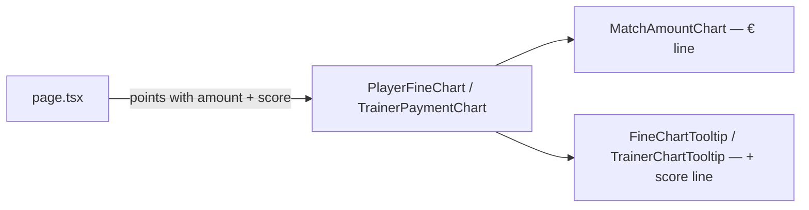

# Requirements

Changelog: feature (all) — extends the unreleased entry `2026-10-26-match-money-chart` once the
developer has approved the result in the browser.

### Overview & Goals

The money charts on the player and trainer pages (`docs/plans/player-fine-chart.md`,
`docs/plans/trainer-payment-chart.md`) show one € amount per match. The tooltip of each point
now also shows the pins scored in that match: the player's own total, or the team total for a
trainer.

A second line was tried first, as two stacked panels sharing the date axis with a solo legend.
It looked bad in the browser and was reverted. The chart stays a single € line.

### Scope

**In Scope**
- `score` on the chart points and a "Celkom: 612" / "Tím spolu: 3912" line in both tooltips.

**Out of Scope**
- Any second line, panel, legend, second axis or new colour token.
- Threshold lines (600 / 700 / 3750).
- New locale keys: the labels reuse `dict.playerDetail.total` and `dict.trainerDetail.teamTotal`.

### Functional Requirements

- Player score: the row's `total`. It is `null` for a substitute's (`'minor'`) row, which holds
  only its own whole lanes, and for `total = 0`. That matches the table's "-".
- Trainer score: the match's `teamTotalScore`, with `null`/`0` mapped to `null`.
- A `null` score renders no line in the tooltip.

# Technical Design

### Current Implementation

`MatchAmountChart` plots `MatchChartPoint.amount`. The two wrappers render
`FineChartTooltip` / `TrainerChartTooltip` per point. `PlayerMatchResult.total` and
`TrainerMatchRow.teamTotalScore` already reach the pages.

### Proposed Changes

#### 1. `lib/match-chart.ts`
`scoreOrNull(score)` returns `null` for `null` or `0`, and the score otherwise.

#### 2. Points (`lib/player-fine-chart.ts`, `lib/trainer-payment-chart.ts`)
- `FineChartPoint.score` and `TrainerChartPoint.score` are both `number | null`.
- `FineChartSource` gains `total`.
- Player: `score: r.substitutionRole === 'minor' ? null : scoreOrNull(r.total)`.
- Trainer: `score: scoreOrNull(m.teamTotalScore)`.

#### 3. Tooltips
- `FineChartTooltipLabels` and the new `TrainerChartTooltipLabels` gain `score`.
- A muted `{labels.score}: {point.score}` line sits under the match name.

#### 4. Pages
- Player: `score: dict.playerDetail.total`.
- Trainer: `score: dict.trainerDetail.teamTotal`.

### Architecture Diagram

### Key Decisions
- **Score in the tooltip, not on the plot.** The stacked-panel version looked bad in the
  browser, and a second scale on one plot would mislead.
- **A substitute's row shows no score**, the same as the table's "-".

### Edge Cases / Risks
- A match with no score yet (trainer) or a substitute's row: the tooltip simply has no score
  line.

# Delivery Steps

### ✓ Step 1: `scoreOrNull` with tests
Touches: `lib/match-chart.ts`, `lib/match-chart.test.ts`.

### ✓ Step 2: Score on the points, with tests
Touches: `lib/player-fine-chart.ts` + test, `lib/trainer-payment-chart.ts` + test.

### ✓ Step 3: Score line in both tooltips, with tests
Touches: `components/player/FineChartTooltip.tsx` + test, `components/trainer/TrainerChartTooltip.tsx`
+ test, `components/trainer/TrainerPaymentChart.tsx`.

### ✓ Step 4: Wire the labels in both pages
Touches: `app/[lang]/player/[id]/page.tsx`, `app/[lang]/trainer/[id]/page.tsx`.

### ✓ Step 5: Final quality check
`pnpm check` passes.

# Testing

### Validation Approach
- `lib/match-chart.test.ts`: `scoreOrNull` at `null`, `0`, `612`, `3912`.
- `lib/player-fine-chart.test.ts`:
  - the score equals `total` for a normal row and for a `'major'` row;
  - `null` for a `'minor'` row and for `total = 0`.
- `lib/trainer-payment-chart.test.ts`: the score equals `teamTotalScore`; `null` for `null` / `0`.
- Tooltip tests: "Celkom: 612" / "Tím spolu: 3912" rendered; no score line for `null`.
- Manual (developer, after restarting `pnpm dev`): tap points on both pages and check the score
  line against the table's "Celkom" / "Tím spolu" column.
- Final: `pnpm check`.
