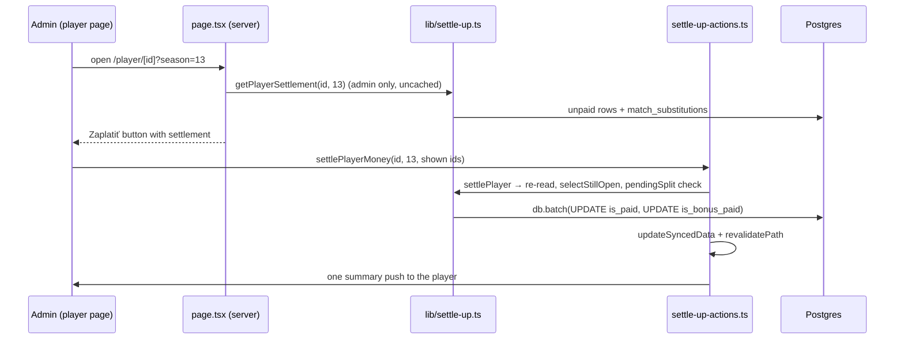

# Requirements

Changelog: feature (admin)

### Overview & Goals

Players settle their debt at the alley in one go: every fine since they last paid, and the
bonuses the bank owes them in return. Today the admin has to open each match on
`/money/[matchId]` and flip one player's toggle per match. Trainers have the same problem with
their `trainer_payments`.

Goal: one admin-only **"Zaplatiť"** button on the player page and on the trainer page. It
settles everything still open for the selected season in a single confirmed action.

### Scope

**In scope**
- Player page `/[lang]/player/[id]`: the button marks every unpaid fine row as paid
  (`is_paid`) and every unpaid bonus as paid out (`is_bonus_paid`), in the selected season,
  across all leagues.
- Trainer page `/[lang]/trainer/[id]`: the button marks every unpaid `trainer_payments` row of
  that trainer in the selected season, across all leagues, as paid.
- A confirmation dialog with the breakdown: fines sum and match count, bonuses sum and match
  count, and the net result. For a trainer: the payments sum and match count.
- Confirm pays exactly the rows the dialog showed. Rows that changed state in the meantime
  are skipped.
- The player payment is blocked while any of the fine rows waits for a substitution lane split
  (`needs_fault_split`).
- The player or trainer gets one summary push per action instead of one per row.

**Out of scope**
- Partial payments, or choosing which matches to settle (the per-match toggles remain for that).
- Bulk undo (corrections stay on `/money/[matchId]`).
- Settling across several seasons.
- Any change to how fines or bonuses are calculated. `recalculateDerivedFinancials()` is
  untouched, and so are the Money Calculation Rules and the `rules` locale namespace.

### User Stories

1. As an admin, on a player's page with unpaid money in the season, I see "Zaplatiť" under the
   amounts. Players and trainers never see it.
2. When I tap it, a dialog shows: Pokuty 12 € (3 zápasy) · Bonusy 40 € (1 zápas) ·
   "Hráč dostane 28 €" (or "Hráč zaplatí X €", or "Vyrovnané").
3. On confirm, all of those rows are marked paid, the page refreshes, and the button
   disappears.
4. If one of those matches still needs the substitution split, the dialog says which match
   and links to its `/money/[matchId]` sheet. Confirm stays disabled, and the server refuses
   with `pendingSplit` as well.
5. The player gets one push, titled "Vyrovnané". Its body has three variants: both, fines only,
   or bonuses only.
6. On a trainer's page I get the same button and dialog ("Platby 30 € (3 zápasy)"), and the
   trainer gets one push.

# Technical Design

### Current Implementation

- Per-match payment goes through `applyMatchMoney()` (`lib/match-money-actions.ts`, admin-only
  server action), which calls `applyMatchMoneyUpdates()` (`lib/match-money.ts`). That function
  writes the flags, then derives one `finePaid` / `bonusPaid` / `trainerPaid` push per row with
  `deriveSettlementPushes()` (`lib/push-digest.ts`). The action then calls
  `updateSyncedData()`, `revalidatePath` for the money, player and trainer pages, and
  `sendPersonalMoneyPushes()`.
- UI: `PaidToggle` and `MarkAllPaidButton` (`components/money/`). `MarkAllPaidButton` is the
  pattern to copy: an `AlertDialog` that stays open on failure and maps error codes to
  localized strings.
- Substitution split lock: `validateSubstitutionSplit()` (`lib/validation/substitution.ts`)
  refuses with `paidLocked` once the starter's or the substitute's row is paid.
  `toSheetSubstitution()` (`lib/substitutions.ts`) computes `needs_fault_split`, and
  `getMatchSubstitutions(matchId)` (`lib/match-substitutions.ts`) returns them per match.
- Push texts come from `push.events.<event>.{title,body}` in `locales/*.json`, and the builder
  is `buildPushPayload()` (`lib/push-payload.ts`). `PUSH_EVENTS` and `EVENT_PATHS` list every
  event.
- Admin checks on pages use `getSession()` and `session?.user.role === 'admin'` (as in
  `app/[lang]/money/[matchId]/page.tsx`). The player page has no session read yet.

### Proposed Changes

#### 1. Pure settlement logic (`lib/settle-up-summary.ts`, db-free)

The client dialog imports its types, so this file must stay db-free.

```ts
export interface PlayerSettlementRow {
  matchId: number;
  opponent: string | null;
  fine: number;          // calculated_fine + streak_fine
  bonus: number;         // bonus_received
  isPaid: boolean;
  isBonusPaid: boolean;
  needsFaultSplit: boolean;
}

export interface PlayerSettlement {
  fineMatchIds: number[];   // unpaid rows with fine > 0
  bonusMatchIds: number[];  // not paid out, bonus > 0
  fines: number;            // sums rounded to cents
  bonuses: number;
  net: number;              // fines - bonuses; > 0 player pays, < 0 player receives
  pendingSplit: { matchId: number; opponent: string | null }[]; // among fineMatchIds only
}

export function summarizePlayerSettlement(rows: PlayerSettlementRow[]): PlayerSettlement;

/** Intersects what the dialog showed with what is still open now. */
export function selectStillOpen(
  settlement: PlayerSettlement,
  shown: { fineMatchIds: number[]; bonusMatchIds: number[] },
): { fineMatchIds: number[]; bonusMatchIds: number[] };

export interface TrainerSettlementRow { id: number; matchId: number; amount: number; isPaid: boolean }
export interface TrainerSettlement { paymentIds: number[]; matchCount: number; total: number }
export function summarizeTrainerSettlement(rows: TrainerSettlementRow[]): TrainerSettlement;

/** One push for the whole settlement: picks the both / fines-only / bonuses-only event. */
export function playerSettlementPush(userId: string, fines: number, bonuses: number): PersonalPush | null;
export function trainerSettlementPush(userId: string, total: number): PersonalPush | null;

/** What a confirmed selection actually settles, for the notification. */
export function settledAmounts(rows: PlayerSettlementRow[], selection: SettlementSelection): { fines: number; bonuses: number };
```

A bonus row does not lock the split: `validateSubstitutionSplit` checks `is_paid` only, and
the bonus depends on `position_total`, not on faults. So `pendingSplit` looks at the fine rows
only.

#### 2. Queries and writes (`lib/settle-up.ts`, server-only)

- `getPlayerSettlement(externalPlayerId, seasonId)`:
  - Selects the player's `match_player_results` joined to `matches` with
    `m.season_id = seasonId` and no league condition. Columns: `match_id`, `opponent`,
    `calculated_fine + streak_fine`, `bonus_received`, `is_paid`, `is_bonus_paid`, `user_id`.
  - Sets `needsFaultSplit` by calling `getMatchSubstitutions()` for the distinct match ids of
    the unpaid fine rows. These are few, so a loop over `Promise.all` is fine. A row counts
    when `needs_fault_split` is true and the player is the starter or the substitute.
  - Returns `{ userId, settlement: summarizePlayerSettlement(rows) }`, or null for an unknown
    player.
- `settlePlayer(externalPlayerId, seasonId, shown)`:
  - Re-reads through `getPlayerSettlement()`, then applies `selectStillOpen()`.
  - Throws `SettleUpError('pendingSplit')` if any selected fine match is still pending, and
    `'nothingToSettle'` when both id lists are empty.
  - Writes through a single `db.batch` (transaction): one `UPDATE match_player_results SET
    is_paid = true WHERE user_id = $1 AND match_id IN (...) AND NOT COALESCE(is_paid,false)`,
    and one equivalent statement for `is_bonus_paid`.
  - Returns the settled totals plus `playerSettlementPush(...)`.
- `getTrainerSettlement(trainerId, seasonId)` and `settleTrainer(trainerId, seasonId,
  shownPaymentIds)`: the same shape over `trainer_payments` joined to `matches`, with
  `inArray(id) AND user_id = trainerId AND NOT is_paid`.
- Paid flags are the only writes, and no derived field changes, so nothing is recalculated.
  This matches `applyMatchMoneyUpdates()`, which recalculates only when misses change.

#### 3. Server actions (`lib/settle-up-actions.ts`, `'use server'`)

```ts
export type SettleUpActionError = 'unauthorized' | 'invalid' | 'notFound' | 'pendingSplit' | 'nothingToSettle' | 'unknown';
export type SettleUpActionResult = { success: true } | { success: false; error: SettleUpActionError };

export async function settlePlayerMoney(externalPlayerId: number, seasonId: number,
  shown: { fineMatchIds: number[]; bonusMatchIds: number[] }): Promise<SettleUpActionResult>;
export async function settleTrainerMoney(trainerId: string, seasonId: number,
  shownPaymentIds: number[]): Promise<SettleUpActionResult>;
```

Each action follows `applyMatchMoney()`:

- It checks that the user is an admin, validates the inputs (integer ids, `isUuid(trainerId)`),
  and calls `lib/settle-up.ts`.
- It then calls `updateSyncedData()` and `revalidatePath` for the money list, the money sheet,
  the player page and the trainer page.
- It sends the push with `sendPersonalMoneyPushes()` and writes
  `logActivity('admin', 'settlePlayerMoney' | 'settleTrainerMoney', { … counts, totals })`.
- It never throws: a `SettleUpError` maps to its code, and anything else maps to `unknown`.

#### 4. Push events (`lib/push-payload.ts`, `lib/push-digest.ts`)

- Add `moneySettled`, `finesSettled`, `bonusesSettled` and `trainerSettled` to `PUSH_EVENTS`.
  Map all of them to `'money'` in `EVENT_PATHS`, and add them to `PERSONAL_PUSH_EVENTS` /
  `PersonalPushEvent` so the CLI parser accepts them. They are not in `MATCH_EVENTS`, because a
  settlement has no single match.
- Params: `{ fines, bonuses }` / `{ fines }` / `{ bonuses }` / `{ amount }`.

#### 5. UI (`components/money/SettleUpButton.tsx`, `'use client'`)

- The structure copies `MarkAllPaidButton`: a `Button` that triggers an `AlertDialog`, error
  codes mapped from `translations.errors`, the dialog staying open on failure, and a
  `Loader2` while pending.
- Props: `target: { kind: 'player'; externalPlayerId: number; settlement: PlayerSettlement } |
  { kind: 'trainer'; trainerId: string; settlement: TrainerSettlement }`, `seasonId`, `lang`,
  `labels`.
- The dialog body shows the lines whose sum is > 0. Each line's count goes through `pluralize`
  (`lib/i18n/plural.ts`), e.g. "Pokuty: 12 € (3 zápasy)". For a player it adds the net line:
  `netPays` / `netReceives` / `netEven`.
- When `pendingSplit` is non-empty, the dialog shows a warning per match, linking to
  `/${lang}/money/${matchId}`, and Confirm is disabled.
- Layout is mobile-first: the button is full width under the amounts on mobile and auto width
  from `md:`.

#### 6. Pages

- `app/[lang]/player/[id]/page.tsx`:
  - Read `getSession()`. When the user is an admin, also load `getPlayerSettlement(playerId,
    selectedSeasonId)` uncached, so the dialog never shows stale amounts.
  - Render `<SettleUpButton>` under the amount lines when
    `fineMatchIds.length + bonusMatchIds.length > 0`.
- `app/[lang]/trainer/[id]/page.tsx`: the same, with `getTrainerSettlement(id,
  selectedSeasonId)`, rendered under `TrainerPaymentSummary` when `paymentIds.length > 0`.
- The dialog always covers the whole season, whatever the league filter. Its title says so
  ("za celú sezónu").

#### 7. Locales (`locales/{sk,cs,hu,sr}.json`) and dictionary type

Use the `translations` skill. Add a new `settleUp` namespace:

| key | sk |
|---|---|
| `button` | Zaplatiť |
| `playerTitle` | Vyrovnať celú sezónu |
| `trainerTitle` | Vyrovnať celú sezónu |
| `description` | Všetky nezaplatené pokuty a bonusy v tejto sezóne sa označia ako vyrovnané. |
| `trainerDescription` | Všetky nezaplatené platby v tejto sezóne sa označia ako zaplatené. |
| `fines` | Pokuty: {amount} € ({count}) |
| `bonuses` | Bonusy: {amount} € ({count}) |
| `payments` | Platby: {amount} € ({count}) |
| `netPays` | Hráč zaplatí {amount} € |
| `netReceives` | Hráč dostane {amount} € |
| `netEven` | Vyrovnané, nikto nikomu nič nedlhuje |
| `pendingSplit` | Zápas s {opponent} čaká na rozdelenie chýb pri striedaní. |
| `confirm` / `cancel` | Potvrdiť / Zrušiť |
| `errors.{unauthorized,notFound,pendingSplit,nothingToSettle,unknown}` | … |

Push texts go under `push.events`. All of them use the title "Vyrovnané":
- `moneySettled`: "Tvoje pokuty {fines} € sú zaplatené a bonusy {bonuses} € ti boli vyplatené."
- `finesSettled`: "Tvoje pokuty spolu {fines} € sú zaplatené."
- `bonusesSettled`: "Bonusy spolu {bonuses} € ti boli vyplatené."
- `trainerSettled`: "Tvoje platby spolu {amount} € sú zapísané ako zaplatené."

The match count (`{count}`) is a pluralized "zápas" built in the component with `pluralize`.
cs, hu and sr are translated with the same meaning, and sr uses Latin script.

### Architecture Diagram



### Key Decisions

- **Season-wide, all leagues** (not the league filter). Under a league filter the shown debt
  leaves out `streak_fine`, but `is_paid` settles the whole row, so following the filter would
  settle money the admin didn't see.
- **Fines and bonuses in one button.** This matches the real flow at the alley, and the net
  line makes the direction of the money explicit.
- **New dedicated write path instead of looping `applyMatchMoneyUpdates()`.** A loop would
  re-read every sheet, write row by row with no transaction, and send one push per row.
  `db.batch` makes it all-or-nothing, and the summary push is the decided behavior.
- **Pay exactly the rows shown.** The admin never confirms an amount they didn't see. Rows
  paid elsewhere in the meantime drop out silently.
- **Block on pending split.** Paying a row locks the split (`paidLocked`), so paying first
  would freeze a possibly wrong amount.
- **Uncached settlement read.** It runs only for admins on a dynamic page, so it costs one
  query and is never stale.

### Edge Cases / Risks

- Unpaid rows with fine 0 or bonus 0 are not touched.
- `'minor'` substitution rows carry their own fines and shared bonuses, and they settle like
  any other row.
- With net 0 (fines = bonuses), the dialog shows `netEven` and settling still works.
- A trainer approved after the season started only has rows after a recalculation. The
  settlement reads whatever rows exist.
- Double click or two admins at once: the `AND NOT is_paid` guards make the second write a
  no-op, and the second action returns `nothingToSettle`.
- Neon returns numeric sums as strings, so wrap them with `Number()`. Round to cents with the
  existing rounding helper used in `push-digest.ts`.
- Client/Server boundary: `SettleUpButton` imports only `settle-up-actions.ts` (a server
  action module) and `settle-up-summary.ts` (db-free), never `settle-up.ts`.

# Delivery Steps

### ✓ Step 1: Pure settlement logic + tests
Write `lib/settle-up-summary.ts` and `lib/settle-up-summary.test.ts`, test first.

### ✓ Step 2: Push events
Change `lib/push-payload.ts` and `lib/push-digest.ts`, add the `push.events.*` texts to
`locales/*.json`, and extend `lib/push-payload.test.ts`. Verify with
`pnpm test:run lib/push locales`.

### ✓ Step 3: Queries and writes
Write `lib/settle-up.ts`. Verify by type check and by reading one real player's settlement
read-only against the database.

### ✓ Step 4: Server actions + tests
Write `lib/settle-up-actions.ts` and `lib/settle-up-actions.test.ts`. Follow the mocking style
of `lib/match-money-actions.test.ts`, and assert on outcomes rather than SQL strings.

### ✓ Step 5: Dialog component + tests
Write `components/money/SettleUpButton.tsx` and `components/money/SettleUpButton.test.tsx`.

### ✓ Step 6: Wire the pages and locales
Change `app/[lang]/player/[id]/page.tsx`, `app/[lang]/trainer/[id]/page.tsx`, add the
`settleUp` namespace to `locales/*.json`, and update the dictionary type if it is not inferred.

### ✓ Step 7: Changelog entry
Use the `changelog` skill in Mode 2. The developer approves the text, then the entry goes in
`lib/changelog/entries/2026-11-07-settle-up-button.ts` (`feature`, `admin`) and is registered
in `index.ts`.

### ✓ Step 8: Final check
Run `pnpm check` (lint + type check + tests) and make sure it passes clean.

# Testing

### Validation Approach

- **`lib/settle-up-summary.test.ts`** (table-driven):
  - Sums of fine and bonus. A fine is `calculated_fine + streak_fine`, so the streak fine is
    included under every condition.
  - Rows with fine 0 or bonus 0 are excluded, and paid rows are excluded.
  - Cent rounding for ⅓ shares (0.34 + 0.33 + 0.33).
  - Net > 0, < 0 and = 0.
  - `pendingSplit` comes only from unpaid fine rows: a paid row with a pending split and a
    bonus-only row with a pending split do not block.
  - `selectStillOpen` drops ids paid in the meantime and ignores ids that were never shown.
  - Push variant selection: both / fines only / bonuses only / nothing gives null.
  - Trainer sum and distinct match count.
- **`lib/settle-up-actions.test.ts`**:
  - Non-admin gives `unauthorized`.
  - Success invalidates (`updateSyncedData`, `revalidatePath`) and sends exactly one push.
  - `SettleUpError` codes map through, and an unexpected throw gives `unknown`.
  - An invalid trainer id gives `notFound`.
- **`components/money/SettleUpButton.test.tsx`**:
  - Renders the exact amounts, the pluralized counts and the net line for all three
    directions.
  - The pending-split warning disables Confirm.
  - A failed action keeps the dialog open with the mapped error string.
- **`lib/push-payload.test.ts`**: the new events build the right title, body and `/money` URL
  in all four locales.
- **`locales/locales.test.ts`**: guards key and placeholder parity.
- **Manual**:
  - As admin, open a player with several unpaid matches in season 13. Tap Zaplatiť and check
    the dialog against the match table, then confirm.
  - Every row now shows as paid, the button is gone, and `/money` totals have dropped.
  - Log in as a player and check the button is absent.
  - Repeat on a trainer page.
  - Check light and dark mode at mobile width.
- **Final**: `pnpm check` passes.
